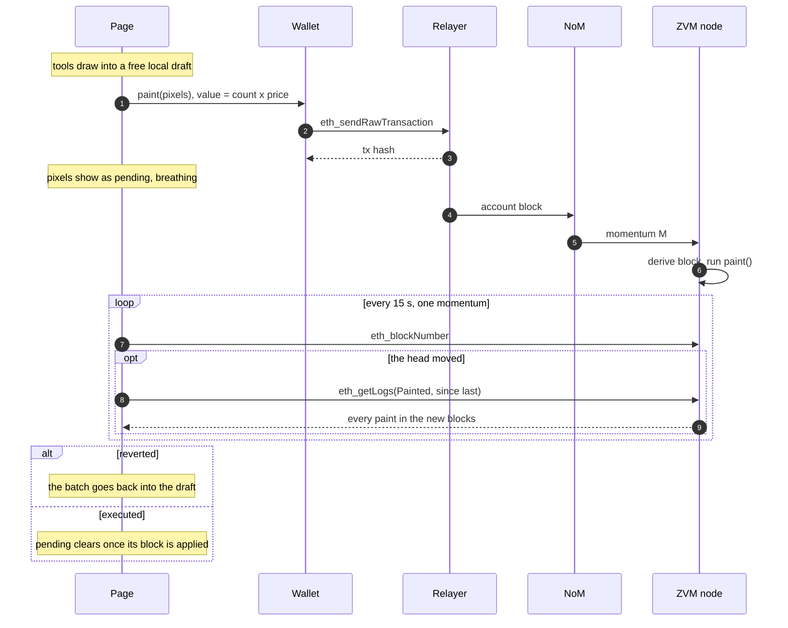
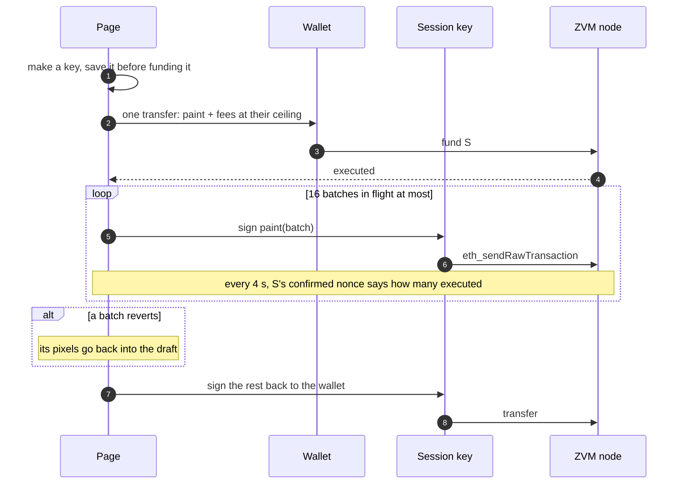

# zvm-mozaic guide


Mozaic is a shared 1000 x 1000 canvas on the ZVM, in the spirit of Satoshi's
Place and r/place. Anyone can paint any pixel any of 16.7 million colours for
0.0001 ZNN a pixel. A later paint covers an earlier one. Nobody owns a pixel,
and there is no cooldown.

- `contracts/Mozaic.sol`: the canvas. It stores the pixels and holds the
  payments until its owner withdraws them.
- `contracts/MozaicRouter.sol`: the front door the page and the scripts
  paint through. It takes paint in a compact form, and it credits a paint
  session's pixels to the wallet that funded it.
- `src/`: the page, a static bundle for GitHub Pages. It has no backend; it
  talks to whichever node you point it at.
- `scripts/`: the command line for people and bots, the deploy, the contract
  tests and the live browser check.
- `deployments/zvm.json`: where the canvas is deployed, written by the deploy
  and read by the page at build time; kept out of git, as every devnet deploys its own.

| | First deployment (chain 7340469) |
|---|---|
| Mozaic | `0x634ebbafb3427958879854ca2ed216a327803d1b`, verified exact |
| MozaicRouter | `0x0f44f47192aa32e7f812110992e88cec58b64f49`, verified exact |
| Owner | `0xE5Ef96Ac84e8fFDBD83f07Cd7e1c23A144498E9b` |
| Price | 0.0001 ZNN a pixel, fixed at deployment |
| Deployed behind | devnet.zenon.foo, once |

The owner can do three things, and nothing else:

- `withdraw(to)`: send everything painting has paid to `to`.
- `clear()`: the whole canvas back to blank, in one transaction.
- `transferOwnership(next)`: hand all three powers to `next`.

The owner can't change the price or paint for free. The canvas was deployed
by a generated key, which then transferred ownership to the address above.
That key (`secrets/owner-7340469.json`, git-ignored) now has no powers at all.

**Clearing is an epoch, not a wipe.** Zeroing 100,000 storage slots would
cost about 500M gas, thirty times the transaction cap. So each epoch has its
own canvas in storage, and `clear()` moves to the next, empty one: about
30,000 gas, and the whole board is blank at once. It emits `Cleared(epoch)`.
The page listens for it, so every open tab goes blank at the same block.

The first canvas, `0xa46b…86d8` with router `0x4ecc…6b29`, had no `clear()`.
It's still on chain. Before it was replaced, its 192.34 ZNN pot
was withdrawn to the owner's address.

## How a paint travels



A draft is split into transactions of up to 4,000 pixels and 400 storage
slots each: the worst case, 400 blank slots of ten pixels, is about 11.4M gas
against Karst's 16.7M cap. The whole canvas is 250 transactions.

### Paint sessions: the whole canvas, one wallet prompt

A draft of more than one transaction goes through a paint session, the
burner-key pattern game front ends use for the same reason:



The key sits in `localStorage` under `mozaic.session.<chain>` from before the
funding transfer. If the tab closes mid-paint, the next visit finds it and
offers to return what it holds. Stop halts sending: what is already in flight
is waited for, since it's paid for, and then the rest is returned. "Sign every
transaction in my wallet instead" turns sessions off.

A full canvas costs about 100 ZNN of paint plus about 290 ZNN of fees at the
100 gwei tip, and the session is funded with the fees at 1.5x, so the wallet
needs roughly 540 ZNN, of which about 150 comes back. The faucet's 5 ZNN is
enough to test with a few thousand pixels.

The draft itself is two canvas-sized typed arrays, not a Map, and it's saved
to IndexedDB as six bytes a pixel, because a full draft outgrows
`localStorage`. The measured timings, in headless Chrome: a corner-to-corner
rectangle drafts all million pixels in 2 s and undoes in 0.2 s.

### The router: fewer bytes, and the right name

On a dynamic-plasma chain the relayer can afford about three full NoM blocks of data per
momentum, because dynamic plasma prices data. The relayer's `/status` says
so: `"blocksPerMomentum":3`. That makes painting throughput a question of
bytes. At the canvas's six bytes a pixel, a session got about two 4,000-pixel
paints into each momentum.

`MozaicRouter` takes two ops and expands them to the canvas's format in
memory, which costs gas but no NoM bytes:

| Op | Bytes | Paints |
|---|---|---|
| `0x01` index(3) count(2) rgb(3) | 9 | `count` pixels of one colour |
| `0x02` index(3) count(2) rgb(3) x count | 6 + 3 x count | `count` pixels, a colour each |

`src/core/ops.ts` encodes the ops and cuts a draft into transactions. The page
imports it, and so do the scripts: Node runs the `.ts` file directly. Each
transaction is filled to whichever limit comes first: 13.5M gas of modelled
cost, or 12 KB of ops, so it fits one NoM block with no chunking. A solid
colour is 9 bytes a transaction whatever its size, so a full-canvas fill is
gas-bound: about 4,500 new pixels or 11,000 repaints per transaction. A photo
is byte-bound at about 4,000 pixels. Transactions now declare 1.1x their gas
estimate, down from 1.3x. The relayer budgets each momentum by *declared*
gas, so the old margin cost about a quarter of the room.

Measured through the router on a fork of chain 69 (`npm run test:router`):

| Paint | Ops | Gas | Model |
|---|---|---|---|
| 4,000 pixels, one colour, blank rows | 9 bytes | 11.80M | 1.04x |
| the same, repainted | 9 bytes | 4.96M | 1.11x |
| 4,000 pixels of noise, blank rows | 12,006 bytes | 12.23M | 1.04x |

The canvas credits whoever calls it, which for a paint through the router is
the router itself. So the router logs `PaintedBy(artist, sender, count)` just
before the canvas's `Painted`, in the same transaction, and the page and
`mozaic watch` credit the paint to `artist`. A paint session is funded through
`open(session)`. That records the funding wallet as the session key's owner,
so its paints are credited to the wallet. The first funder of a key owns it,
and nobody else can fund or claim it after. Session paints made before the
router existed were sent straight to the canvas, so they stay credited to
their session keys; they drop out of the one-day window a day after they were
painted.

## Loading, and what it costs the node

The page reads the canvas once as a snapshot: ten `eth_call`s to
`chunk(start, 10000)`, three at a time. The rows fill in as the answers
arrive. Only painted slots come back, so an empty canvas costs almost nothing
to read and a full one about 3.6 MB. The page then replays every `Painted`
event after the block number it read before the snapshot. Events apply in
chain order and the last write wins, so it doesn't matter which block each
chunk was read at. No archive state is needed.

After that the page looks at the chain once per refresh interval, 15 s by
default: one momentum, which is as fast as a new block can land. The node
dialog offers 15 s, 30 s, 1 min or paused. Each look is one `eth_blockNumber`.
Only when the head has moved does it read that block (for the base fee) and
make one `eth_getLogs`. The contract's totals are read at most once a minute.
A hidden tab doesn't poll at all. An open tab costs the node about four small
requests a minute, plus one log read per block that actually moved.

Who painted each pixel comes from events rather than state, so the page knows
it for the last day (5,760 blocks) and not before.

## Costs

The pixel price goes to the contract. The network fee goes to the chain.
On this devnet the fee is usually the larger of the two: the relayer requires
a 100 gwei tip, and storage writes are what a paint mostly pays for. Measured
on a fork of chain 69 (`npm run test:contract`):

| Paint | Gas a pixel | Fee a pixel at 100 gwei | Plus the price |
|---|---|---|---|
| Blank rows, 2,000 pixels in one transaction | 2,858 | 0.00029 ZNN | 0.0001 ZNN |
| The same rows repainted | 1,148 | 0.00011 ZNN | 0.0001 ZNN |
| 400 scattered pixels, each in its own blank slot | 22,926 | 0.0023 ZNN | 0.0001 ZNN |

Ten pixels share a storage slot, so painting along rows is ten times cheaper
than scattering. The contract keeps the slot it is editing in memory until
the index moves on, and both the page and the scripts send pixels sorted.
Painting a pixel the colour it already has is skipped for free: the page
leaves it out of the transaction, and the scripts do the same unless given
`--all`.

## The page

It uses Vue 3, Vite, Tailwind 4 and viem, styled like the other ZVM front
ends. It's built for GitHub Pages: `.github/workflows/pages.yml` builds on
every push to `main`, with the organisation's `ZVM_NODE` Actions variable, under
`/<repo>/`, or under `/` when `public/CNAME` exists. Its only settings are a node and a contract, and both can change
without a rebuild:

- **node**: the node menu, or `?rpc=` in a link. The default is the node
  `VITE_ZVM_NODE` names at build time; no node is built in, and the build stops
  without it (`.env.example` has a local zvm-devnet's).
- **contract**: `?contract=` in a link, the node menu (kept per chain),
  `VITE_MOZAIC_CONTRACT`, and finally `deployments/*.json` by chain id.

Any EVM JSON-RPC works. When the RPC is a zvm node's (it ends in `/rpc`, with
`/api/info` beside it), the page also links to its explorer and offers its
faucet.

What it adds over Satoshi's Place, which had one pencil and sixteen colours:

- **Any colour.** A saturation/value field, a hue bar, hex, R G B, 42
  swatches, recent colours, and a second colour on the right mouse button.
- **Ten tools.** Brush (square or round, 1 to 32 px), eraser (draft only),
  line, rectangle and ellipse (filled or outlined), flood fill with
  tolerance (the whole canvas if need be), gradient fill, spray, colour picker (or Alt-click), and move.
- **Brush opacity** blends over what's there. **Mirror** painting works
  left-right, top-bottom, or both.
- **Images:** stamp one into the draft at any width, or pin it as a
  see-through guide to trace. Choose a file, drop it on the canvas, or paste
  it with Ctrl+V.
- **A free draft** up to the whole canvas, with undo and redo, kept across
  reloads. It shows the cost live, and drafted pixels that already match the
  canvas are free. More than one transaction is painted through a **paint
  session**: one wallet prompt, however big the draft.
- **Pending paints** breathe until their block lands. **Other people's
  paints** get a pink ring as they arrive.
- **Live and Top painters** lists for the last day. Click a paint to fly to
  it.
- Pixel info under the pointer: colour, the draft's colour, who painted it,
  when.
- A minimap, a pixel grid when zoomed in, links that keep the view
  (`?x=&y=&z=`), PNG download, keyboard shortcuts for everything (`?`
  lists them), pinch and two-finger pan on phones.
- A faucet button when a wallet can't cover its draft.
- **Gallery**, at `/gallery`: the canvas alone, full screen if you like, with
  no header, tools or panels. It looks at the chain every 10 seconds, and Esc
  goes back to the canvas.

## Bots and scripts

Everything goes through `scripts/mozaic.mjs`, set up by environment
variables:

| Variable | |
|---|---|
| `MOZAIC_RPC` | default `ZVM_RPC`; one of them must be set |
| `MOZAIC_CONTRACT` | default: `deployments/*.json` for the RPC's chain |
| `MOZAIC_ROUTER` | default: the router in that record; `none` paints the canvas directly |
| `MOZAIC_KEY` or `MOZAIC_KEY_FILE` | the painter's key; reads need none |

```sh
npm install
npm run mozaic -- key                                # secrets/bot.key, a new address
export MOZAIC_KEY_FILE=secrets/bot.key
npm run mozaic -- faucet                             # 5 devnet ZNN
npm run mozaic -- info
npm run mozaic -- paint 10 10 '#ff0000' 11 10 '#00ff00'
npm run mozaic -- rect 100 100 50 20 '#00d557' [--outline]
npm run mozaic -- line 0 0 999 999 '#0061eb'
npm run mozaic -- image logo.png 400 300 --width 64 [--alpha 128]
npm run mozaic -- json pixels.json                   # [{"x":1,"y":2,"color":"#ff0000"}], or - for stdin
npm run mozaic -- keep logo.png 400 300 --width 64 --every 60 --max-znn 2
npm run mozaic -- get 500 500
npm run mozaic -- snapshot canvas.png [x y w h]
npm run mozaic -- watch                              # every paint, as JSON lines
npm run mozaic -- withdraw 0x...                     # owner only: the pot to 0x...
npm run mozaic -- clear                              # owner only: the canvas back to blank
npm run mozaic -- transfer-ownership 0x...           # owner only
```

Every paint command skips pixels that already have the colour, prints the
cost before sending, and takes `--dry-run` and `--max-znn N`. `keep` guards
an image: it rereads only the slots the image covers and repaints whatever
someone changed. A bot left running needs the `--max-znn` guard more than
anything else. Polling commands never look more often than once per
momentum.

Any other language needs only this:

```
paint(bytes pixels)  payable, value = count * price()
  pixel = index (3 bytes) || r || g || b     index = y * 1000 + x
pixel(x, y) -> 0xRRGGBB
chunk(start, count) -> (uint32 slot || uint256 value)*, painted slots only
slotAt(slot) -> uint256, pixel slot*10+k in bits 24k..24k+23, XOR 0xFFFFFF
epoch() -> which canvas is current; each clear() adds one
event Painted(address indexed painter, uint256 count, bytes pixels)
event Cleared(uint256 indexed epoch)
```

A pixel never painted and a pixel painted white are the same zero in storage.
The page shows both as blank, over a grid of space-grey squares.

## Building, deploying, testing

```sh
npm run contract:build     # contracts/Mozaic.json and src/core/abi.ts
npm run test:contract      # every rule, against an anvil fork (see the file's header)
npm run test:router        # the router: exact expansion, sessions, and the gas model
npm run deploy -- --record deployments/zvm.json   # --rpc, or ZVM_RPC
npm run dev                # http://localhost:47700/zvm-mozaic/
npm run verify             # headless Chrome paints for real on ZVM_RPC's chain
```

`deploy` pays gas from the devnet deployer (zvm's dev EVM key 900). It
generates the owner key unless given `--owner`, reads the contract back, and
verifies the source on the node's explorer. Each step checks the chain first,
so rerunning it finishes a deploy that stopped partway. The contract is built
with solc 0.8.19 for paris, the combination Bullet Game and Rain already run
on the ZVM.

`verify` funds a throwaway key from the faucet and gives it to a stand-in
EIP-6963 wallet. It draws a filled rectangle, recolours it with the fill tool,
walks undo and redo, adds a brush line, and pays through the Paint button.
It then reads the pixels back from the chain with `scripts/lib.mjs`, which
checks the page's encoding against the scripts'. It also fails if the light
theme or a 400 px phone scrolls sideways.

The page runs every animation whatever the OS reduced-motion setting says; see
the root `CLAUDE.md`.
